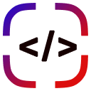

# Install

[Install extension from Chrome Web Store](https://chrome.google.com/webstore/detail/locatorjs/npbfdllefekhdplbkdigpncggmojpefi) (works for Chrome, Brave, Opera and Edge)

[Install extension from Firefox Add-ons](https://addons.mozilla.org/cs/firefox/addon/locatorjs/)

# Requirements

**The extension works automatically on development builds** of React, Preact,
Solid, Vue and Svelte apps (Next.js, Vite, Create React App, SvelteKit, Nuxt,
…). It reads the source metadata those frameworks attach to DOM nodes in
development mode; production builds strip it, so there is nothing to read.

It does not need React DevTools, and it never installs its own
`__REACT_DEVTOOLS_GLOBAL_HOOK__`, so both extensions run side by side.

# Troubleshooting

## What the popup tells you

Open the popup on the page. Above the settings it shows one card explaining
why Locator is not running there, and what to do:

| Card                                                        | Meaning                                                                                                                                                                           |
| ----------------------------------------------------------- | --------------------------------------------------------------------------------------------------------------------------------------------------------------------------------- |
| Looking for your app…                                       | The page has not rendered a supported framework yet. Slow dev servers land here for a while.                                                                                      |
| No supported framework on this page                         | The page rendered, but nothing Locator supports is on it. If it named a framework, that one is unsupported.                                                                       |
| _React_ is here, but without source locations               | A supported framework without its development metadata — almost always a production build. Start the dev server and open that URL. Svelte also needs the compiler's `dev` option. |
| Locator couldn't start on this page                         | The page blocked `client.bundle.js`, usually with a strict Content-Security-Policy. The raw error is under _Details_.                                                             |
| Locator is turned off for all sites / Disabled on this page | You switched it off. _Turn on_ re-enables it without a reload.                                                                                                                    |
| Locator can't run here                                      | Browser-internal pages, the extension store and PDF viewers do not run content scripts.                                                                                           |
| Reload to finish updating Locator                           | The extension updated while the tab was open.                                                                                                                                     |

_Check again_ makes Locator sample the page once more. The same status is on
`document.documentElement.dataset.locatorPageStatus` as JSON if you want it
from the console.

## Broken source info

Locator is connected (no card in the popup) but shows no bounding boxes when
holding Alt/Option and moving the mouse, or the box is there but the link
points to the wrong place.

- **Make sure the project runs in development mode.** `process.env.NODE_ENV`
  should be `development`.
- React 19 puts the JSX call site on `_debugStack`; older React on
  `_debugSource` via [babel-preset-react](https://babeljs.io/docs/en/babel-preset-react). A custom Babel setup without the preset has no source info.

## Broken links

When I click on a component's bounding box, it doesn't go to editor

- It is possible that your editor doesn't have registered URL handler. Check browser console for errors. If you get something like `Failed to launch 'vscode://...24:11' because the scheme does not have a registered handler.`, try reinstalling your editor.

## Debug Mode

If source locations are incorrect or navigation fails, enable Debug Mode to troubleshoot:

### How to enable

1. **Settings panel** (recommended): Click the LocatorJS icon, open settings, and toggle "Debug Mode" on
2. **Console command**: `window.__LOCATORJS_DEBUG__ = true` or `enableLocatorDebug()`

### Console output

When enabled, clicking an element will log resolution details to the console:

```
[LocatorJS] Starting source resolution
  Fiber: <div> (tag: 5)
  DOM element: <div class="xxx">...</div>

[LocatorJS] [sync] Source found
  Method: fiber._debugSource
  Component: <div>
  Location: /app/page.tsx:15:0

[LocatorJS] Location complete
  Final method: fiber._debugSource
  Target location: /app/page.tsx:15:0
```

### Supported resolution methods

| Type  | Methods                                                                                             |
| ----- | --------------------------------------------------------------------------------------------------- |
| Sync  | `fiber._debugSource`, `elementType._source`, `type._source`, `memoizedProps.__source`, `_debugInfo` |
| Async | `rendererInterfaces API` (React DevTools 7.0.1+), `Turbopack chunk`, `source-map` reverse lookup    |

### View debug history

```javascript
window.__LOCATORJS_DEBUG_HISTORY__;
```

# Development

## Run extension locally

```bash
# Development mode (Chrome)
pnpm dev

# Development mode (Firefox)
pnpm dev:firefox
```

## Build & Release

### Dependency-aware release pipeline

```bash
# Package Chrome version (builds deps + extension + zip)
pnpm run release:chrome

# Package Firefox version
pnpm run release:firefox

# Package all versions
pnpm run release

# Skip dependency build (re-package extension only)
node utils/release.js --skip-runtime
```

The `release:node*` commands remain compatibility aliases for existing release
automation. All release entry points now run the same dependency-aware Node
pipeline before packaging.

### Packaging an existing build (unsafe)

```bash
pnpm pack:unsafe:chrome  # -> build/chrome.zip
pnpm pack:unsafe:firefox # -> build/artifacts_firefox/
```

These commands package whatever is already in `build/production_*`; they do not
rebuild dependencies or the extension. Use `pnpm run release:chrome`,
`pnpm run release:firefox`, or `pnpm run release` for release artifacts.

### Build output

| Version | Build directory             | Package file                    |
| ------- | --------------------------- | ------------------------------- |
| Chrome  | `build/production_chrome/`  | `build/chrome.zip`              |
| Firefox | `build/production_firefox/` | `build/artifacts_firefox/*.zip` |

## Load unpacked extension

**Chrome:**

1. Open `chrome://extensions/`
2. Enable "Developer mode"
3. Click "Load unpacked"
4. Select the `build/production_chrome` directory

**Firefox:**

1. Open `about:debugging#/runtime/this-firefox`
2. Click "Load Temporary Add-on"
3. Select `build/production_firefox/manifest.json`

# Contributing

To develop of contribute to this project [continue here](./../../contributing.md)
